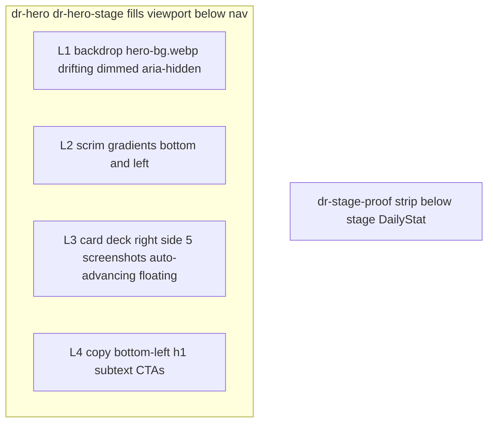

# Hero Redesign: Live Session Stage

Replace the side-by-side hero grid with a full-viewport "live session" stage, per the
design-taste-frontend skill and the user's confirmed concept choice.

## Design Read (skill Section 0.B)

A competitive-gaming tooling page whose hero should feel like a live draft session in
progress, not a brochure.

**Dials:** DESIGN_VARIANCE 8 (unique layout explicitly requested) / MOTION_INTENSITY 6
(automatic perpetual motion, CSS-only) / VISUAL_DENSITY 4 (baseline).

**Redesign mode (skill Section 11):** Redesign - Preserve. Targeted hero recomposition
(Lever 5). Copy voice, CTAs, anchor IDs (`#top`, `#process`), nav, and analytics-facing
labels stay. Page stays dark-only (`#070a10` family) with the single `#e83f4e` accent.

## Concept

The whole viewport becomes the stage. Three motion layers, all transform/opacity, all
CSS keyframes, no scroll listeners:

1. **Backdrop** - full-bleed Jett key art (`/images/Homepage/hero-bg.webp`), dimmed and
   desaturated, drifting slowly (scale/translate, 30s alternate).
2. **Card deck** - the 5 product screenshots as a floating deck on the right: front card
   plus two peeking behind (offset, rotated, dimmed). Auto-advances through the session
   lifecycle every 4.5s: drafting tool, team balance, tournament bracket, match found,
   result poster. The whole deck bobs gently (8s alternate float).
3. **Copy** - anchored bottom-left over a legibility scrim: h1 (2 lines), subtext
   (14 words), 2 CTAs.



## Markup changes - src/pages/LandingPage.jsx

1. `HERO_VARIANT = "stage"` (new value; `"jett"` and `"workflow"` branches and their
   components stay for reversibility).
2. New `HeroStage({ slides })` component:
   - `.dr-stage-backdrop` (aria-hidden, decorative img with alt="").
   - `.dr-stage-deck > .dr-stage-deck-inner` wrapping 5 `.dr-stage-card` figures.
   - Per-card delay: card at array index j gets
     `animationDelay: calc(${total - 1 - j} * -4.5s)` so play order follows array order
     (lifecycle order). Negative delays avoid the initial static state (same technique
     as the existing `HeroSlideshow`).
   - Loading: backdrop img `fetchPriority="high"` + eager + `decoding="async"`; front
     card eager; back cards `loading="lazy"` + `decoding="async"`.
3. Hero section: `className={"dr-hero" + (stage ? " dr-hero-stage" : "")}`. Render
   `<HeroStage>` before the copy div when stage. The copy div stays a direct child
   (stage CSS positions it absolutely). `DailyStat` leaves the copy block.
4. `<DailyStat />` moves to `<div className="dr-stage-proof">` rendered right after the
   hero section (all variants). Component logic untouched. Reason: skill hero-stack
   discipline - max 4 text elements, no trust micro-strip inside the hero.
5. Em-dash fix: `<span className="sr-only">Draftix — </span>` becomes `Draftix: `
   (skill Section 9.G zero-tolerance; screen readers hear sr-only text).

## Motion spec - reference keyframes

22.5s cycle = 5 cards x 4.5s. Card is FRONT at local 0%. Tune percentages during
implementation; verify the handoff: the old card exits up and fades during the last
~1s of its slot while the next glides from back-right to front.

```css
@keyframes dr-stage-card {
  0%, 15.5%  { transform: none; opacity: 1; z-index: 4; }
  19.5%      { transform: translate(6%, -38%) scale(.92) rotate(2.5deg); opacity: 0; z-index: 4; }
  19.51%     { opacity: 0; z-index: 0; }
  56%        { transform: translate(-8%, 10%) scale(.84) rotate(-4deg); opacity: 0; z-index: 1; }
  61%        { opacity: .5; }
  80%        { transform: translate(-8%, 10%) scale(.84) rotate(-4deg); opacity: .5; z-index: 1; }
  92%        { transform: translate(8%, 5%) scale(.92) rotate(3deg); opacity: .75; z-index: 2; }
  99.9%      { transform: translate(8%, 5%) scale(.92) rotate(3deg); opacity: .75; z-index: 2; }
  100%       { transform: none; opacity: 1; z-index: 4; }
}
@keyframes dr-stage-float { from { transform: translateY(-10px); } to { transform: translateY(10px); } }
@keyframes dr-stage-drift { from { transform: scale(1.08) translateX(-1.2%); } to { transform: scale(1.14) translateX(1.2%); } }
```

Float lives on `.dr-stage-deck-inner`, not the positioning wrapper (the wrapper uses
`transform: translateY(-50%)` for vertical centering; transforms must not fight).

## CSS changes - src/styles/landing-redesign.css (append at end)

**Critical:** the file contains layered `.dr-hero` override blocks (around lines 490,
597, 709, 824, 842, 962, 1224). The stage block must be appended LAST and use compound
selectors (`.dr-site > .dr-hero.dr-hero-stage ...`, 3 classes) so it out-specifies every
earlier 2-class rule.

- Stage section: `position:relative; display:block; overflow:hidden; isolation:isolate;
  min-height:calc(100dvh - 82px); padding:0;` (overrides the grid and padding-top rules).
- Backdrop: absolute inset 0; img `object-fit:cover`, `filter:brightness(.5)
  saturate(.75) contrast(1.05)`, drift animation.
- Scrim (backdrop::after): `linear-gradient(0deg, rgba(7,10,16,.92), transparent 46%)`
  plus `linear-gradient(90deg, rgba(7,10,16,.7), transparent 40%)` for copy legibility.
- Deck: absolute, `top:50%; right:clamp(32px,6vw,96px); transform:translateY(-50%);
  width:min(42vw,600px); aspect-ratio:16/10;`.
- Cards: absolute inset 0; img `object-fit:cover`; `border:1px solid
  rgba(255,255,255,.14); border-radius:28px 28px 8px 28px;` (existing hero-visual
  radius - shape consistency lock); deep shadow; cycle animation with per-card delay.
- Copy: absolute, `left:clamp(24px,5vw,88px); bottom:clamp(36px,7vh,84px);
  max-width:560px;` h1 `clamp(3.2rem,5.8vw,6rem)` (smaller than the grid variant; it is
  overlaid and shares the viewport with the deck). The existing `[data-reveal]` stagger
  cascade keeps working (class names unchanged).
- Proof strip: `.dr-stage-proof` slim strip below the hero, hairline top border,
  container width, ~18px vertical padding; restyle the `.dr-hero-proof` chip for this
  context.
- Responsive:
  - 1280-901px (existing breakpoint convention): deck width 46vw, copy max-width 480px;
    watch deck/copy collision - shift deck up (`top:44%`) if needed.
  - 900px and below: backdrop stays absolute full-bleed; deck + copy switch to in-flow
    stacked (deck ~44vh first, copy below, padding-bottom 48px) - avoids overlap on
    short screens.
  - 560px and below: deck ~38vh, h1 `clamp(2.6rem,13vw,4rem)`, actions full-width grid
    (existing pattern).
  - Short desktop (height 720px and below, width above 900px, existing convention):
    cap h1 with vh, cap deck height.
- Reduced motion (append to the existing reduce block or add a new one):

```css
@media (prefers-reduced-motion: reduce) {
  .dr-stage-backdrop img, .dr-stage-deck-inner { animation: none; }
  .dr-stage-card { animation: none; }
  .dr-stage-card:not(:first-of-type) { display: none; }
}
```

Static front card = drafting tool; same collapse pattern as the existing
`.dr-hero-stream` reduce block.

## Skill compliance notes

- Hero stack: 3 text elements (h1, subtext, CTAs) - under the max of 4; no eyebrow added.
- Headline 2 lines, subtext 14 words, CTAs visible without scroll.
- Motion motivated: deck cycle = storytelling (a draft session lifecycle); float and
  drift = the "alive" ask. Transform/opacity only, no scroll listeners.
- Real images only (existing screenshots + key art); no pills overlaid on images
  (captions dropped from the deck; alt text carries descriptions).
- Color lock: single `#e83f4e` accent. Theme lock: dark (existing brand, unchanged).
- Zero em-dashes in any visible or screen-reader string (fix included; grep during
  verification).

## Verification

1. `npm run build` passes.
2. Visual check at 1440px, 1024px, 900px, 390px widths - deck and copy never collide,
   hero fits the viewport, CTAs visible.
3. DevTools reduced-motion emulation - static front card, no drift, no float.
4. Grep hero strings for em-dash and en-dash characters - zero matches.
5. Skill pre-flight spot-check: hero discipline, shape and color locks, motion claimed
   equals motion shown.

## Files touched

- `draftix-react/src/pages/LandingPage.jsx` - variant switch, HeroStage component, hero
  restructure, DailyStat relocation, em-dash fix.
- `draftix-react/src/styles/landing-redesign.css` - additive stage block, keyframes,
  responsive rules, reduced-motion block.
